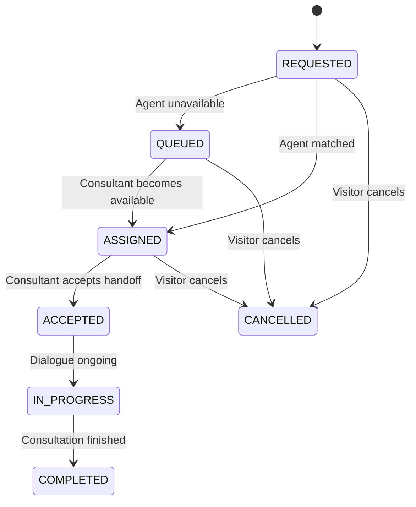

# Amnaya AI Consultant — Human Handoff & Sales Consultant Escalation

## Architectural Overview

Phase 7.9 provides a production-ready Human Handoff and Sales Consultant Escalation system for the Amnaya AI Sales Consultant. The primary business rule is:

> **The AI must NOT attempt to answer every question or hallucinate facts.**

When queries exceed verified knowledge, involve price negotiations/discounts, request custom modifications, or contain explicit visitor requests for human assistance, the system transfers or offers handoff to an Amnaya Sales Consultant while preserving full dialogue context.

```text
Visitor
   ↓
AI Consultant (Intent Engine & RAG Guardrails)
   ↓
Needs Human?
   ├── No  → Return AI Response
   └── Yes → Initiate Sales Handoff
              ↓
         Handoff Service
              ↓
         Sales Handoff Record (QUEUED / ASSIGNED)
              ↓
         Sales Consultant Dashboard (Context & Executive Summary)
              ↓
         Live Consultant Engagement
```

---

## Escalation Triggers

| Trigger | Description | Example Query |
| :--- | :--- | :--- |
| `explicit_human_request` | Visitor explicitly asks for a human / sales consultant | *"I want to talk to someone"*, *"Connect me to sales"* |
| `unknown_verified_information` | Query asks for facts missing from verified RAG store | *"Tell me something that isn't in your information"* |
| `negotiation_request` | Visitor asks for price reduction or special discount terms | *"Can you give me your best discount?"*, *"Can you reduce the price?"* |
| `custom_requirement` | Bespoke spatial or architectural layout modification request | *"I have a custom floor plan requirement"* |
| `high_intent_lead` | High intent purchase signals requiring consultant assistance | High scoring visitor viewing units, comparing, & calculating EMI |
| `complex_financial_question` | Non-standard mortgage or custom tax structuring | *"Can you explain custom mortgage structuring?"* |
| `complaint` | Service concern or visitor complaint | *"I am unhappy with the assistance"* |
| `repeated_ai_failure` | Consecutive failure / clarification count >= 2 | AI unable to resolve query twice in succession |
| `sales_followup_request` | Explicit request for sales team phone follow-up | *"Can someone call me around 5 PM?"* |

---

## Handoff Lifecycle State Machine



---

## Handoff Context & Sales Summary

When a handoff is requested, `HandoffService` generates a non-hallucinated, structured context package containing:

- **Lead Metadata**: Name, contact details, assigned lead ID.
- **Preferences**: Typology (e.g. 3 BHK), budget range (e.g. ₹2.00 Cr - ₹3.00 Cr), preferred view (e.g. Lake View), preferred floor (e.g. High Floor).
- **Unit Context**: Interested unit numbers (e.g. 1804, 1904), compared unit numbers.
- **Calculations & Site Visit**: Financial EMI calculation summaries and site visit booking status.
- **Visitor Request**: Last query and specific visitor notes.

---

## API Endpoints

- `POST /api/v1/ai/handoff`: Initiate handoff request.
- `GET /api/v1/ai/handoff/{handoff_id}`: Retrieve status for visitor/lead.
- `GET /api/v1/ai/handoffs/queue`: List active queue for sales staff/admin.
- `POST /api/v1/ai/handoff/{handoff_id}/accept`: Consultant accepts handoff.
- `POST /api/v1/ai/handoff/{handoff_id}/complete`: Complete handoff with notes.
- `POST /api/v1/ai/handoff/{handoff_id}/cancel`: Cancel handoff request.
- `GET /api/v1/ai/handoff/analytics/metrics`: Operational metrics (counts, acceptance rate, completion rate, wait time).

---

## Data Privacy & Security

- Internal system prompts, raw chain-of-thought, and API keys are strictly excluded from handoff payloads.
- Lead isolation checks restrict visitor access to authorized sessions only.
- Sales consultants and administrators access assigned handoff records via authenticated RBAC routes.

---

## Testing & Verification

Comprehensive test suite in `backend/tests/test_human_handoff.py` (50 test scenarios):
- Explicit triggers, unknown fact escalation, negotiation escalation, repeated failure tracking, context building, status lifecycle transitions, consultant routing strategies, security isolation, and knowledge-gap logging.
